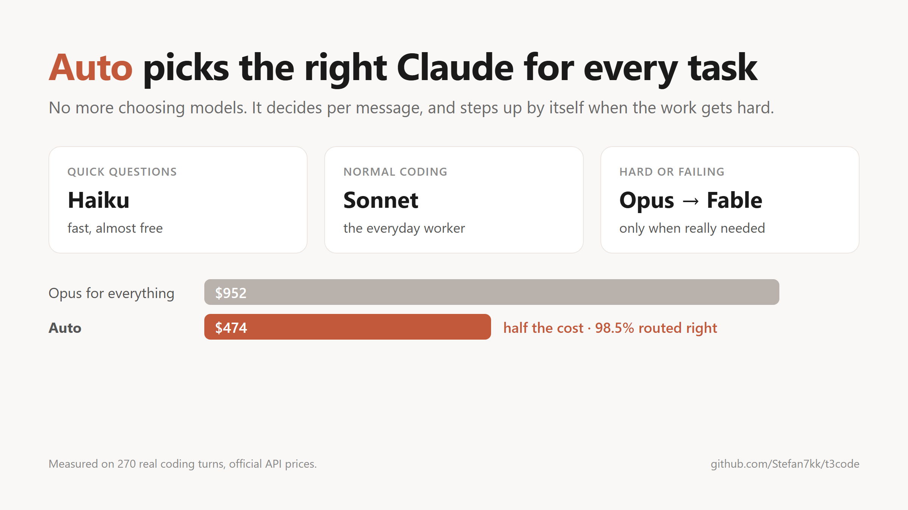

<h1 align="center">T3 Code Enhanced</h1>

  An unofficial fork of <a href="https://github.com/pingdotgg/t3code">T3 Code</a> that picks the right model and effort for every message.

  
  
  

  

## Why use it

Choosing a model for every message is tedious, and getting it wrong costs either money or quality.
Set the model and effort to **Auto** and it decides for you, one message at a time:

| The message | Auto picks |
| --- | --- |
| Quick question, lookup, "OK" | **Haiku**, low effort |
| Normal coding, fixes, features | **Sonnet**, medium or high effort |
| Architecture, security, hard design | **Opus**, high effort |
| The task keeps failing | **Opus** after 2 failures, **Fable** after 4, then back down once it passes |

Escalation is based on what actually happens during the work (failing tests, tool errors, loops), not on keywords alone.
Short follow-ups such as "done?" keep the model the task is already using, so ongoing work is never dropped to a weaker model.

**Measured** on 270 real coding turns at official API prices: Auto routed 98.5% of turns correctly, sent no hard task to the
cheap model, and cost **$474** against **$952** for Opus on everything (the same as Sonnet on everything, with Opus and Fable on
call when needed).

## Install

1. Download the `.exe` from the [latest release](https://github.com/Stefan7kk/t3code/releases/latest) and run it.
2. Windows may say *"Windows protected your PC"* because the installer is not code-signed. Click **More info**, then **Run anyway**.
3. Sign in to your providers in **Settings** as usual, then choose **Auto** for the model and effort.

Updates install from inside the app. If you already use the official T3 Code, this replaces it and keeps your threads and
settings. Wait for the next update here if your official version is newer than the latest release.

## Provider support

| Provider | Auto | Status |
| --- | --- | --- |
| Claude | Model + effort | Tested live |
| Codex | Model + effort | Tested live |
| OpenCode | Model + effort | Tested live |
| Qwen (ACP) | Model + effort | Built, not yet tested live |
| Cursor | Model + effort | Built, not yet tested live |

Auto only chooses among the models of the provider you picked. It never moves your work to another provider.

## Also in this fork

- **Routing history** on the Usage page: which model and effort Auto chose for each message, why, and the tokens it used.
- **Route quality**: the share of turns with no sign of a wrong route, judged from failures and escalations only.
- **Qwen Token Plan quota** card on the Usage page.
- **Plugins page** in Settings to switch Claude Code plugins, MCP servers and skills on or off.
- **Telemetry off by default.**
- **Stays current**: every 6 hours it checks for a new official stable release, then merges, tests and publishes it here.
  A release is only published after the full test suite and a secret scan pass.

## Privacy

Everything runs on your computer with your own provider accounts. Routing decisions and their history are stored locally.
Nothing is sent to this project.

## Credits and license

Built on [T3 Code](https://github.com/pingdotgg/t3code) by T3 Tools Inc., released under the [MIT License](../LICENSE).
This fork is not affiliated with or endorsed by T3 Tools Inc. Report problems with this fork in
[its issues](https://github.com/Stefan7kk/t3code/issues), not upstream.

The original project README is at [README.md](../README.md).
